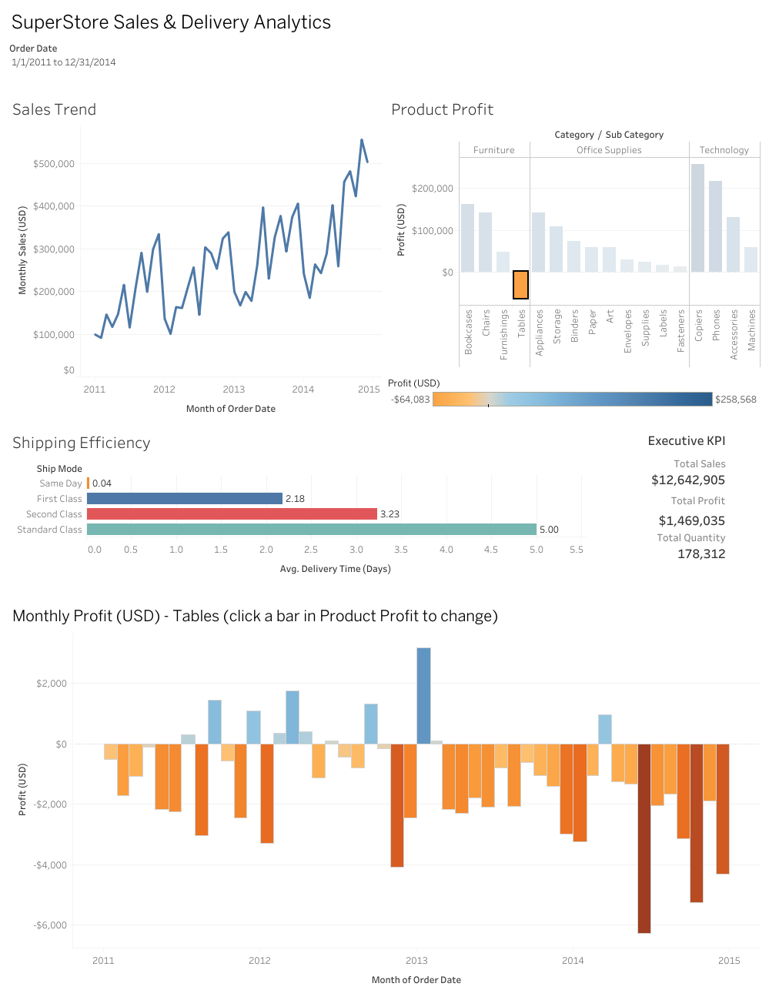

# SuperStore Sales & Delivery Analytics

[](https://www.python.org/)
[](https://pandas.pydata.org/)
[](https://colab.research.google.com/)
[](https://public.tableau.com/views/SuperStoreSalesDeliveryAnalytics/Dashboard1)

An end-to-end analytics project that turns raw SuperStore order data into an interactive Tableau dashboard covering revenue growth, product profitability, shipping efficiency, and when and where losses occur.

[](https://public.tableau.com/views/SuperStoreSalesDeliveryAnalytics/Dashboard1)

## Dashboard

[](https://public.tableau.com/views/SuperStoreSalesDeliveryAnalytics/Dashboard1)

*Click the preview to open the fully interactive version on Tableau Public. The preview shows the Tables sub-category selected.*

**How to use it (on Tableau Public):**
- Use the Order Date slider to focus on a specific period.
- Click any bar in **Product Profit** to see that sub-category's monthly profit in the **Loss Detail** chart. Click an empty area to reset.

## Project Objective

Analyze the historical sales data of a retail SuperStore to uncover actionable insights on revenue growth, product profitability, and supply chain efficiency, and give management clear, data-driven recommendations to reduce losses in underperforming product segments.

## Dataset

| Item | Detail |
|---|---|
| Source | SuperStore Global retail dataset (sample) |
| Size | 51,290 rows, 21 columns (22 after cleaning) |
| Period | January 2011 - December 2014 |
| Coverage | 7 markets, 147 countries |
| Currency | USD (the dataset has no currency column; values are treated as USD) |
| Key attributes | Order Date, Ship Date, Ship Mode, Segment, Category, Sub-Category, Sales, Quantity, Discount, Profit |

## Business Questions

1. What is the Year-over-Year (YoY) trend for sales?
2. Which categories and sub-categories drive the most profit, and which operate at a loss?
3. How do shipping modes compare in average delivery time?
4. What actions can management take to improve margins in loss-making segments?
5. When and where do the losses occur?

## Process

1. **Data cleaning and preprocessing (Python / Pandas, Google Colab)**
   - Audited the raw data: checked dimensions, data types, missing values (none found), and duplicate rows (none found).
   - Converted `sales` from text to numeric.
   - Standardized the date columns. The raw data mixes `dd/mm/yyyy` and `dd-mm-yyyy` formats, so both are parsed day-first with an explicit format and validated to have zero failed conversions.
   - Engineered `delivery_time_days` (ship date minus order date).
2. **Exploratory data analysis (Python)**
   - Aggregated sales and profit by product category and visualized the results with Matplotlib and Seaborn.
   - The final notebook cell recomputes the key figures reported below (growth, margins, discounts, loss timing, shipping times).
3. **Dashboard (Tableau)**
   - Connected the cleaned dataset to Tableau and built an interactive dashboard with a sales trend, a profit-by-sub-category chart, a shipping efficiency chart, executive KPIs, an order date range filter, and a click-to-drill **Loss Detail** chart showing monthly profit for the selected sub-category.

## Key Findings

| Metric (2011-2014) | Value |
|---|---|
| Total sales | $12,642,905 |
| Total profit | $1,469,035 (11.6% margin) |
| Total quantity sold | 178,312 units |

- **Sales growth:** Sales grew every year, from $2.26M in 2011 to $4.30M in 2014. Annual growth was about 18.5% (2012), 27.2% (2013), and 26.3% (2014).
- **Profit drivers:** Technology is the most profitable category ($663,779 profit), led by Copiers ($258,568) and Phones ($216,717).
- **Loss-maker:** Tables is the only loss-making sub-category, at -$64,083 profit (an -8.5% margin) on $757,034 in sales.
- **Heavy discounts coincide with the Tables loss:** Tables carry an average discount of 29% versus 14% across all products, and 75% of Tables order lines are discounted by 20% or more. Those lines lost $125,326 combined, while Tables order lines with smaller or no discounts earned $61,242.
- **Loss timing:** Tables lost money in 37 of 48 months. The 2014 loss (-$30.5K) was more than double the 2013 loss (-$14.0K), with the worst months in June (-$6.3K), October (-$5.3K), and December (-$4.3K) of 2014.
- **Where it hurts:** Tables lost money in the EU (-$21.0K), APAC (-$20.1K), US (-$17.7K), and LATAM (-$12.3K), while Africa, EMEA, and Canada were slightly profitable.
- **Logistics:** Average delivery time is about 0 days for Same Day, 2.2 days for First Class, 3.2 days for Second Class, and 5.0 days for Standard Class. Standard Class handles 60% of all order lines.

## Recommendations

1. **Rework the Tables discount policy.** Cap discounts on Tables (for example below 20%) and review supplier and shipping costs. The losses are concentrated in heavily discounted order lines, not spread across the whole sub-category.
2. **Prioritize where the losses are.** Start the review with the EU, APAC, US, and LATAM markets and with 2014, when the Tables loss more than doubled, and track progress monthly with the Loss Detail chart.
3. **Use Standard Class volume as leverage.** With 60% of order lines shipping Standard Class, negotiate better SLA and rate terms with logistics vendors, aiming to cut shipping cost without lengthening the 5-day average.
4. **Protect the profit engine.** Keep Copiers and Phones well stocked and avoid deep discounting on them.

## Notes and Limitations

- Sales values in the source data are whole numbers (no cents), while profit has decimals.
- The link between discounts and the Tables loss is an association in this data, not proof of cause. Supplier cost and shipping cost may also contribute.
- "Order lines" means individual rows in the dataset, not unique orders.

## Repository Structure

```text
SuperStore-Analytics-Project/
│
├── data/
│   ├── raw_superstore.csv            # Raw dataset before processing
│   └── Cleaned_SuperStoreOrders.csv  # Clean dataset produced by the Python pipeline
│
├── notebooks/
│   └── Superstore_EDA_Cleaning.ipynb # Cleaning and EDA (Pandas) from Google Colab
│
├── images/
│   └── dashboard_preview.png         # Screenshot of the Tableau dashboard
│
├── requirements.txt                  # Python libraries
└── README.md                         # Project documentation
```

## How to Reproduce

1. Open `notebooks/Superstore_EDA_Cleaning.ipynb` in [Google Colab](https://colab.research.google.com/), or run it locally after `pip install -r requirements.txt`.
2. Upload `data/raw_superstore.csv` (or change the path in the first code cell) and run all cells to generate `Cleaned_SuperStoreOrders.csv`.
3. Connect the cleaned CSV to Tableau to rebuild or refresh the dashboard.
   - If Sales, Profit, or Discount appear as text in Tableau, set the text file's locale to English (United States) (Data Source page, table dropdown, Text File Properties).

## Author

**Sendy Tegar Mahendra** · [LinkedIn](https://www.linkedin.com/in/sendytegar) · [Email](mailto:sndy9080@gmail.com)
